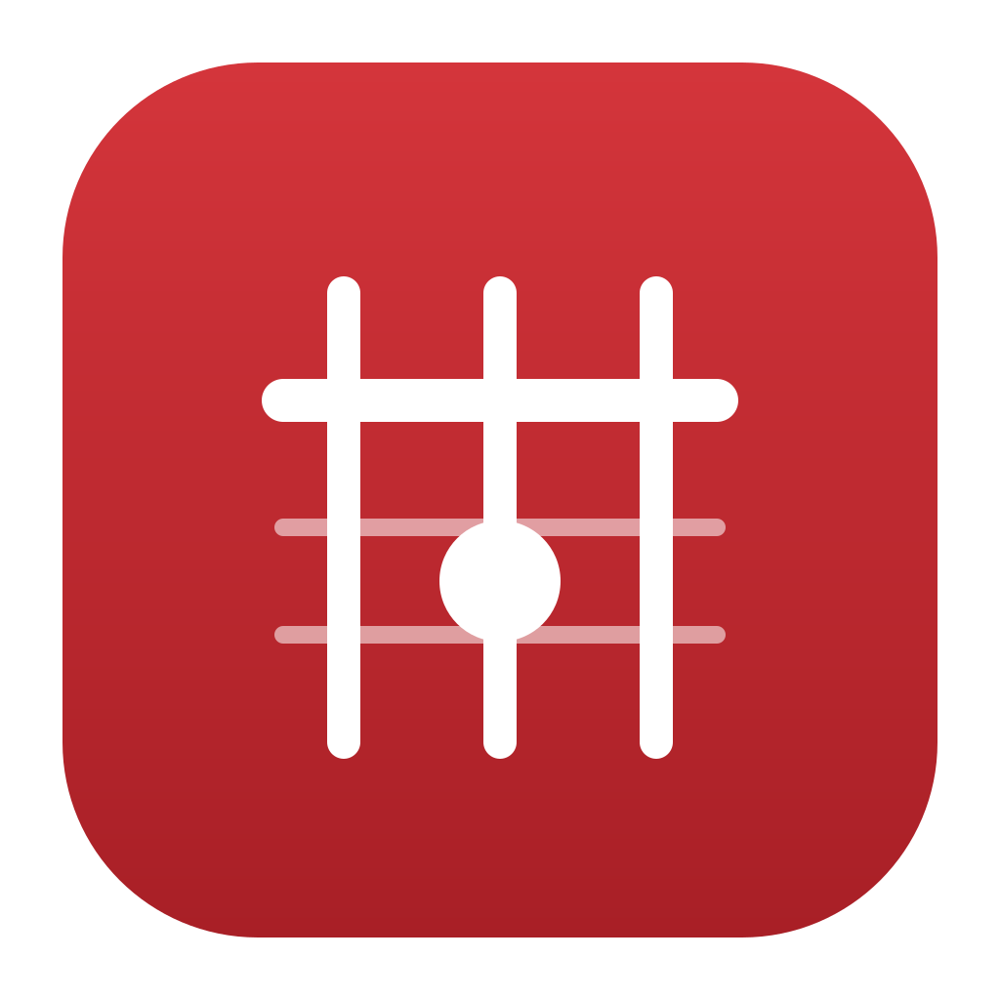
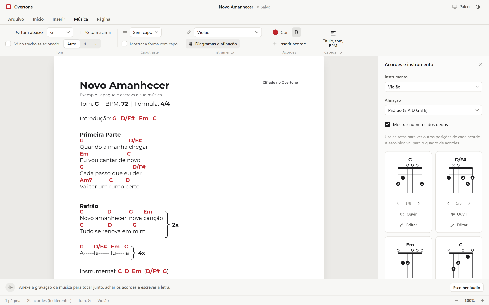
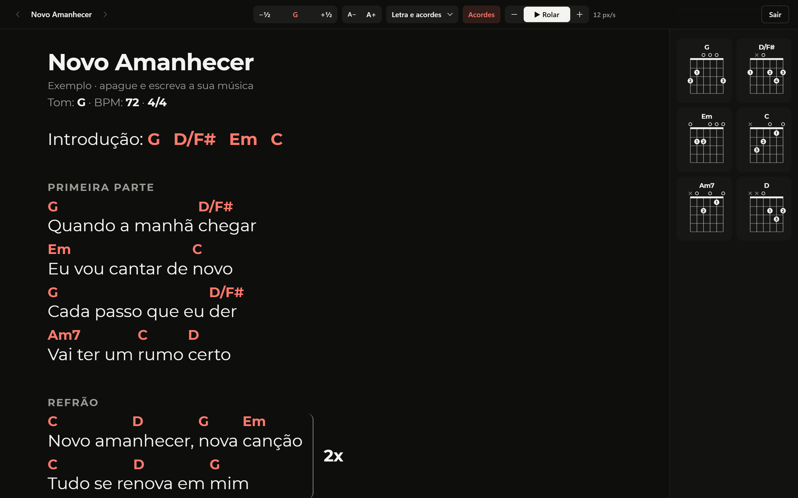
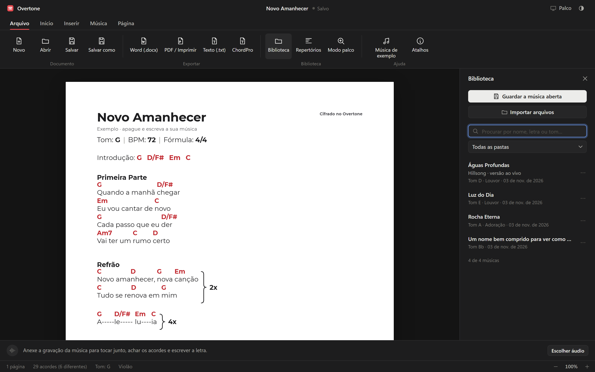

<h1 align="center">Overtone</h1>

Editor de cifras no estilo Word: escreva, mude o tom e toque junto.

  <a href="https://github.com/inflzzz/overtone/releases/latest/download/Instalar-Overtone.exe"><b>Baixar para Windows</b></a> ·
  <a href="https://inflzzz.github.io/overtone/app/">Usar no navegador</a> ·
  <a href="https://inflzzz.github.io/overtone/">Página do programa</a>

## O que ele faz

- **Editor como o Word:** páginas A4, fontes, cores, impressão e PDF
- **Acordes na sílaba certa**, que nunca se encostam, e chave `}` com 2x / 4x
- **Troca de tom** da música inteira ou de um trecho (medley), com sustenido e bemol certos
- **Notação brasileira:** `7M`, `(9)`, `4`, `º`, `m7(b5)`, `7(13)`, baixos invertidos
- **Diagramas** para mais de 40 instrumentos de corda e teclado, com o som do acorde
- **Cabeçalho** com título, tom, BPM e compasso; numeração de página; marca d'água
- **Áudio junto da cifra:** repetir trecho, velocidade, tom acompanhando a cifra, metrônomo; acha acordes, tom e BPM e escreve a letra
- **Biblioteca, repertórios e modo palco** com rolagem automática e pedal
- **Arquivos:** `.cifra`, Word (`.docx`), PDF, texto e ChordPro

## Instalar

1. Baixe o [Instalar-Overtone.exe](https://github.com/inflzzz/overtone/releases/latest/download/Instalar-Overtone.exe).
2. Abra o arquivo. Se o Windows mostrar "O Windows protegeu o computador", clique em **Mais informações** e depois em **Executar assim mesmo** (o instalador ainda não tem assinatura digital paga).
3. O Overtone aparece no menu Iniciar, e os arquivos `.cifra` abrem com dois cliques.

Funciona sem internet. Só a função de escrever a letra a partir do áudio baixa o modelo de voz na primeira vez.

## Fotos

| Modo palco | Biblioteca (tema escuro) |
| --- | --- |
|  |  |

---

Fontes incluídas: Montserrat e Noto Music (SIL Open Font License).
